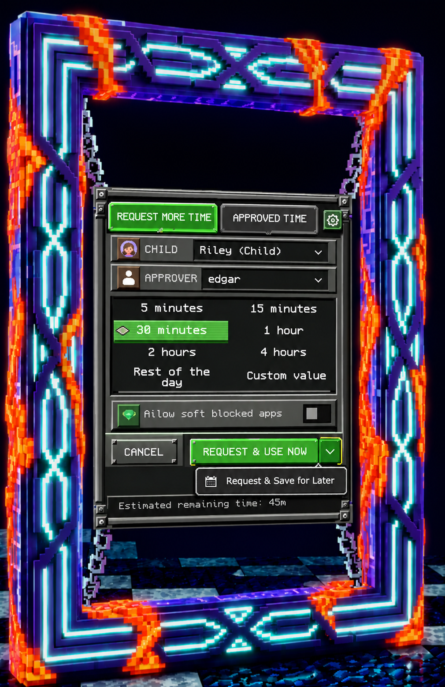
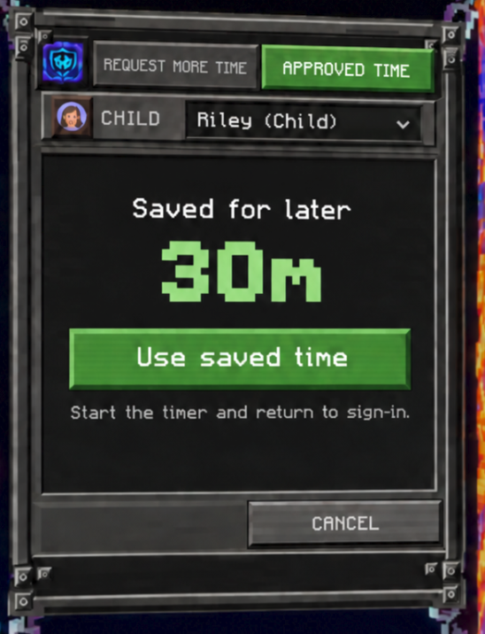
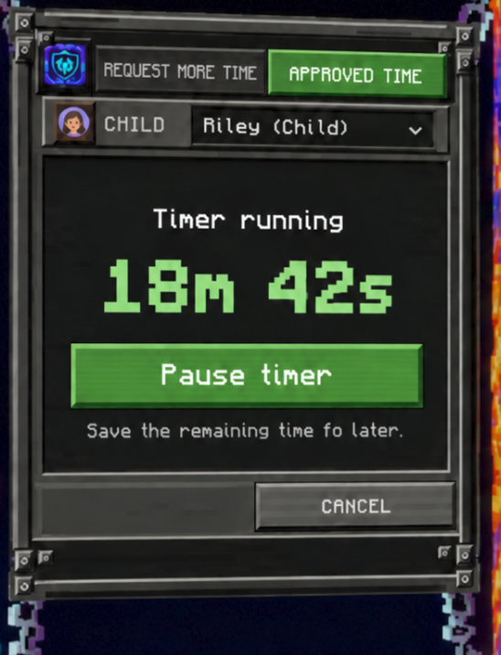

# Save approved time for later design

## Status and reading route

This is the proposed end-to-end implementation design for **deferred approval
and manual pause/resume in both the kiosk and the child overlay**. It records
the agreed customer behavior and GUI direction from the design discussion, plus
the engineering decisions needed to implement them. No feature implementation
or installed acceptance is claimed by this document or its draft images.
All design decisions, including transfer accounting, account binding, external
grants, balance arithmetic, app-policy timing and surface behavior, are settled
and [recorded below](#resolved-design-decisions). The
[native qualification gate](#native-qualification-gate) has verified the
platform behavior the design depends on, on the supported system.

Start product work at [System design](System-Design.md), then use the
[execution plan](Save-For-Later.md) for task order and this design for feature
behavior. The current [specification](Specification.md),
[screen-time design](SystemDesign/Screen-Time.md),
[broker transactions](SystemDesign/Broker.md#authorization-and-grant-transactions),
[state ownership](SystemDesign/State.md), and
[front ends](SystemDesign/Frontends.md) describe the pre-feature implementation.
Update their affected contracts when implementing this design; do not present
the proposed behavior as already shipped.

The feature does not require changes to GDM, GNOME Shell internals, PAM ordering,
or Malcontent's meaning of an active extension. It locks a child session only
through logind's public session lock.

## Customer contract

- A parent can approve additional time for immediate use or for later use, in
  the kiosk and in the child overlay. Both request modes authenticate the
  selected parent.
- Saved time is approved time **beyond** the daily allowance. The daily
  allowance stays independent: saving or pausing never clears or pauses it, and
  using saved time adds the saved seconds on top of the daily time still left.
- Requesting time for later adds the new minutes to saved time. If a
  fixed-duration grant is running, the same request then pauses it and saves its
  remaining time beyond today's daily allowance. If that pause fails, the new
  minutes stay saved, the timer keeps running, and the result says so.
- Both surfaces can pause a running fixed-duration grant without another parent
  approval. In the child overlay, Pause first asks for confirmation and then
  locks the screen immediately, so the child cannot keep using the session on
  paused time. An overlay save-for-later request that pauses a running grant
  locks the same way. If daily time remains, the child can unlock with their
  password and use only that daily time.
- Before the kiosk pauses or uses saved time, it locks any of the child's
  desktops that were switched away from without locking, so the use up to that
  point is recorded. The child unlocks with their password, as after Switch User.
- **Use saved time** starts all saved time in either surface. It is the only
  start operation: there is no separate resume. The kiosk then returns to
  sign-in; the overlay closes and the child continues. Once the child has no
  usable time, only the kiosk can reach Use saved time.
- Saved time survives kiosk exit, logout, broker restart, shutdown, and reboot
  without losing seconds once saving has committed. Revocation, screen-time
  control toggles, account invalidation, and package removal clear it.
- Rest-of-day grants and grants that existed before this feature run to their
  end. They cannot be paused or saved, and Rest of the day cannot be requested
  for later.
- Immediate approvals leave saved time saved.
- Opening the kiosk, locking, switching users, signing out, or suspending does
  not pause a grant. Time runs until an explicit pause takes effect. Once
  started, saved time runs during the return to sign-in and password entry, and
  during later lock/suspend/power-off intervals.
- Parent **Revoke** clears running and saved time, including when only saved
  time exists. Existing strict-app-policy and termination behavior remains.
- An approval's soft-app choice travels with its time. It applies while that
  time runs, never while it is saved, and never beyond the parent's current app
  policy.

Automatic pause on lock and automatic redemption at login/unlock remain outside
the feature.

## Surfaces and the exhausted session

Today the broker writes the public AccountsService property
`ActiveExtension = (issued_at_epoch_seconds, duration_seconds)`. Its remaining
time is `max(0, issued_at + duration - now)`. There is no native deferred/paused
state in that property. The current grant therefore ticks while locked or away.

There are also two different entry restrictions:

1. PAM time checks protect authentication/account admission. Our authentication
   module calls the Malcontent library; `pam_malcontent` is a separate module
   invoked by the system PAM stack during account management.
2. GNOME Shell 50's retained-session unlock UI independently replaces password
   entry with a time-exhausted shield and an **Ignore** button. That shield is
   driven by Shell's time-limit state, not by our PAM module's rejection.

Consequently, a PAM redemption hook alone cannot guarantee that an exhausted
retained session offers password entry. Earlier proposals to skip Malcontent
checks, toggle `LimitType`, or redeem only after unlock are superseded.

The child overlay runs inside the child's unlocked session. While the child has
usable time, it offers every action of this feature in-session. Once the time is
exhausted, the session is behind Shell's shield and fresh logins are refused, so
the overlay cannot be reached. The kiosk is the required route for that case:

```text
Locked child desktop (or no child desktop)
  -> switch to the dedicated kiosk
  -> select child -> Approved time -> Use saved time
  -> broker commits a normal ActiveExtension
  -> kiosk returns to sign-in
  -> return to retained child desktop or start a fresh login
  -> normal time checks and password authentication
```

Malcontent's policy-change/estimate notifications let Shell observe the new
grant. The [native qualification gate](#native-qualification-gate) confirmed
that the existing lock-screen shield clears on the supported Ubuntu 26.04 /
GNOME 50 environment. A stale shield would be a behavior mismatch to diagnose
through public interfaces, not a reason to patch private Shell state. The child
password is still required.

No lock-screen button is hidden or replaced. No product code calls Shell's
native **Ignore** action, takes over Malcontent's extension agent, fakes usage,
sets a distant future grant, or continually renews a temporary grant. The broker
uses its existing verified AccountsService adapter to issue real access, and
logind's `LockSession` for the [lock before capture](#caller-and-session-binding).

Upstream sources inspected for this design:

- [Malcontent ActiveExtension contract](https://gitlab.freedesktop.org/pwithnall/malcontent/-/blob/0.14.0/accounts-service/com.endlessm.ParentalControls.SessionLimits.xml).
- [GNOME 50 parental-controls shield and Ignore action](https://github.com/GNOME/gnome-shell/blob/50.0/js/gdm/authPrompt.js).
- [GNOME 50 unlock state integration](https://github.com/GNOME/gnome-shell/blob/50.0/js/ui/unlockDialog.js).
- [GNOME 50 time-limit manager](https://github.com/GNOME/gnome-shell/blob/50.0/js/misc/timeLimitsManager.js).

## GUI specification and supplied drafts

The supplied images are visual design references, not screenshots of implemented
behavior. They retain the current metal frame, pixel font, green selected/action
surfaces, account artwork, compact proportions, and background. Their text is
illustrative, including its typos; product strings come from this document and
are translated into every supported language.

**On both surfaces, the header contains the tabs Request time and Approved
time.** The tabs share the Preferences dialog’s stepped styling. Open
Preferences from the request screen menu. The shared child selector sits
immediately below the tabs and applies to both pages. The kiosk lists eligible
children. The overlay keeps its selector fixed to the signed-in child. Preserve
the shared form's responsive layout at different display scales.

### Request time



- Preserve duration options, custom validation, soft-app selection, remembered
  request choices, estimate/status area, and Cancel.
- **Retain the approving-parent selector.** Its absence from this draft is an
  omission, not permission to remove account selection or selected-parent
  authentication. It belongs only in this tab, between child and duration fields.
- Primary split-button action: **Request & use now**.
- Dropdown action: **Request & save for later**. It is insensitive while Rest of
  the day is selected, with the explanation “Rest of the day can't be saved.”
- The dropdown is a menu/popover, not a permanently expanded second button.
  Selecting its action closes the menu and submits that request after validation.
  Outside click or Escape dismisses the menu without submitting; that Escape
  must not also close the form.
- Both modes use the same duration/app validation and selected-parent Polkit
  flow. The trusted prompt must name immediate versus saved use, state that saved
  use pauses a running fixed-duration grant, and state that the soft-app choice
  applies when the saved time is used. UI mode cannot change during
  authentication and cannot be silently substituted after authorization.
- In the overlay, when a fixed-duration grant is running, Request & save for
  later first shows the [lock confirmation](#overlay-lock-confirmation). Cancelling
  it submits nothing.
- The estimate uses current balances and distinguishes, for the selected action,
  “remaining if approved” (U after an immediate approval) from “saved if
  approved” (S after a deferred approval). Saved time is shown separately for an
  immediate request because it stays saved. The estimate is advisory; commit
  recalculates after authentication. Invalid-input, loading, authorization, and
  failure messages take precedence over estimates.
- Immediate success keeps each surface's existing behavior: the kiosk confirms
  and exits, the overlay confirms for three seconds and closes. Saved success
  stays in the form and selects Approved time with the committed saved balance;
  it never starts that time. If the pause that follows a saved approval fails,
  show the saved balance together with the pause error; the timer keeps running.
  In the overlay, a deferred request that paused a running grant then locks the
  screen as described for Pause.
- The screenshots' 30-minute selection and 45-minute estimate are illustrative;
  they are not the numeric inputs for the 18 + 20 scenario below.

### Approved time: saved



Show **Saved for later**, the saved balance, **Use saved time**, and a hint. The
kiosk hint is “Start the timer and return to sign-in.”; the overlay hint is
“Add it to your time now.” Do not distinguish paused from newly approved time
or invent a separate Resume endpoint. The draft's 30m is illustrative; the
combined scenario must display about 38m.

Kiosk success uses the existing exit-to-sign-in route; its confirmation must not
suggest that the timer waits for password entry. Overlay success shows the
existing three-second confirmation and closes; the child's panel countdown
reflects the new time at once.

### Approved time: running



Show **Timer running**, the running grant's time beyond today's daily time
(X below), **Pause timer**, and “Save the remaining time for later.” When daily
time also remains, add a secondary line with today's daily time so that the two
amounts add up to the child's countdown. The kiosk display decreases live,
because the child's session is inactive. In the overlay, X stays constant while
the child uses daily time and the grant together, and decreases once daily time
is gone.

Kiosk Pause stays on this tab and changes it to the saved state. Overlay Pause
opens the [lock confirmation](#overlay-lock-confirmation).

### Overlay lock confirmation

The overlay shows a modal dialog inside the shared form before any broker call
that would pause a running grant:

- Title “Pause and lock the screen?”; the request variant is “Save for later and
  lock?”.
- The body shows the estimated saved amount, says that the screen locks now and
  the password is needed to return, and says that saved time is started from
  Approved time on this panel while daily time remains, or at the request station.
- Actions: **Cancel** (default, also Escape) and **Pause and lock**. The request
  variant's **Continue** then opens the parent prompt.

After confirmation, the broker locks the session before it stops the timer. A
pause refused before the lock, such as for a stale revision or a grant that can
no longer be paused, leaves the session unlocked and shows the error. On success
the overlay closes behind the lock screen. On a failure after the lock it stays
open with the error and refreshed status, which the child sees after unlocking;
the grant keeps running if the pause did not commit.

### Other UI states and shared behavior

| State | Approved time page |
| --- | --- |
| No running or saved approved time | “No approved time available” and a “Request more time” action that selects the Request time tab. Daily-only time does not enable Pause. |
| Running grant fully covered by daily time (X = 0) | “Covered by today's daily time”; no Pause |
| Rest-of-day or pre-feature grant running | “Approved until HH:MM”; no Pause |
| Running grant and saved time together | Running row (Pause only for a fixed grant) above the saved row; Use saved time is labelled as adding to the running timer |
| Loading or failed read | Loading/unavailable text with retry; never render an unknown balance as zero |
| Mutation pending or broker busy | Disable account/tab changes and competing mutations; show bounded progress and retain the selected child. While any transaction holds the broker lock, including another child's parent prompt, report busy with retry |
| Recovery pending | “Time status unavailable” with retry; no speculative balance or mutation. Retry rereads status, which starts a recovery attempt; recovery also runs at broker start and before the child's next mutation, and Parent Revoke also resolves it |
| Screen-time control off | Existing disabled-control explanation; no pause, redeem, or request operation |

Show Pause only for a running fixed grant with X > 0, and Use saved time only
with a positive saved balance.

Open Request time by default to preserve today's initial task. Returning
from a kiosk Pause or any saved request selects Approved time. Within one form,
preserve the selected tab when switching children but discard stale asynchronous
replies. Tab switching does not save a request, authenticate, pause, redeem, or
reset duration choices. Cancel/Escape closes the idle form using current rules,
after dismissing an open menu or dialog first. During authentication,
cancellation belongs to the trusted prompt. After a mutation starts, closing or
losing the frontend is not proof of rollback; on return, read its outcome and
current status. Closing does not itself pause time.

Use existing duration formatting and error-report routes. Only the approved
time page has the large one-time balance; do not relabel daily time as saved.
Retain window/application accessibility identity even though the visible title
is replaced. Add stable public accessible IDs and selected/disabled state for
both tabs, balances, status, split menu, timer actions, and the lock
confirmation. Reuse existing IDs for unchanged fields and test both shared-form
surfaces.

## Customer scenarios

### Scenario 1: approve in the kiosk, save the combined grant, use it later

Precondition: screen-time control is enabled for Riley; daily allowance is zero
for the numeric example. Riley has a running fixed-duration grant and locks the
desktop.

1. Riley switches to the kiosk and selects Riley. The grant keeps ticking.
2. On Request time, select the parent, Custom **20 minutes**, the app choice,
   and **Request & save for later**.
3. The selected parent authenticates in the trusted prompt. Assume **18 minutes
   remain at the broker's transfer boundary B**, not at form opening.
4. The broker first adds the 20 approved minutes to saved time. The
   [pause step](#the-pause-step) then ends the running grant at B and adds its
   18 minutes: `18 + 20 = 38 minutes` saved.
5. Kiosk displays Approved time: **Saved for later — 38m**. Waiting does not
   reduce it. Closing the kiosk, signing out, and rebooting preserve it. Riley's
   existing locked desktop is retained unless the machine is rebooted; pausing
   itself never logs the child out.
6. Later, Riley opens the kiosk, selects Riley, and clicks **Use saved time**.
7. The broker moves the saved seconds into a normal active grant exactly once,
   `ActiveExtension := (now, D + 38m)` with D = 0, and empties the saved balance.
   The timer starts now; the kiosk returns to sign-in. Riley can unlock the
   retained desktop or log in after reboot using the normal password, with the
   return/login interval deducted.
8. After natural exhaustion with daily time still zero, the normal restriction
   returns. No saved copy remains for a second redemption.

The same scenario starts from zero active time: approving 20 fixed minutes for
later saves 20 minutes with only a store write. No child login is needed to store
or redeem it. Parent denial/cancellation preserves the prior state, allowing only
the ordinary elapsed decrease of an already running grant.

### Scenario 2: pause existing granted time in the kiosk, then use it later

Precondition: enabled screen-time control, a fixed-duration grant approved after
this feature was installed, and zero daily allowance. Rest-of-day and
pre-feature grants cannot be paused.

1. Riley uses the grant, locks the screen, and opens the kiosk.
2. On Approved time, click **Pause timer**. At the broker's transfer boundary,
   suppose **18m 42s** remain.
3. Without a new parent prompt, the same pause step ends the grant at B and
   saves those seconds. The page becomes **Saved for later — 18m 42s**.
4. Wait, exit, restart the broker, or reboot. The balance stays unchanged.
   A second Pause cannot add another copy of the old grant.
5. Later click **Use saved time**. This calls exactly the same redemption method
   as Scenario 1, starts the saved seconds, and returns to sign-in.
6. Repeat pause/use cycles. The acceptance target is conservation of granted
   seconds across transfers: only running intervals consume time. Another child's
   balance and session are unaffected.

### Scenario 3: pause, save and use time from the child overlay

Precondition: enabled screen-time control; Riley is signed in.

1. With a running fixed-duration grant and no daily time left, Riley opens the
   panel's request overlay, selects Approved time and clicks **Pause timer**.
2. The confirmation appears. **Pause and lock** locks the screen at once; the
   broker then saves the remaining seconds. Because no time remains, the lock
   screen shows the exhausted shield.
3. Later, Riley uses the kiosk's **Use saved time** as in Scenario 1 and unlocks.
4. With 30m daily time left and no grant running, Riley chooses **Request & save
   for later** for 15 minutes in the overlay. The parent authenticates, the
   screen does not lock, and Approved time shows **Saved for later — 15m**.
5. Near the end of daily time, Riley clicks **Use saved time** in the overlay.
   The countdown grows by 15 minutes beyond the remaining daily time, and the
   overlay closes.

These are separate customer acceptance cases even though their transitions share
backend code and reusable test blocks.

## State and time arithmetic

Each child has at most one running grant, the live `ActiveExtension` tuple, and
one saved balance of fixed seconds. Each has its own app choice. Running and
saved time can coexist. There is no queue of independently redeemable grants:
saved time is one balance and is always used in full.

```text
Approve now ----------------------------------> running (saved unchanged)
Approve for later --> save minutes --> saved += N, then the pause step if needed
running fixed -- Pause ---> pause step --> saved += X
saved ---- Use saved time --> redeem ------> running (saved empty)
running/saved ------------- Revoke --------> empty
```

At a single authoritative evaluation time, define:

- `D`: current daily allowance remaining today, from validated Malcontent use.
- `A`: running-grant remaining seconds; zero without a running grant.
- `S`: saved seconds; zero without saved time.
- `N`: newly approved fixed-duration seconds, within current request bounds.
- `X = max(0, A - D)`: running approved time beyond today's daily time.

```text
Usable on the desktop now    U = max(D, A)
Total including saved time   T = max(D, A) + S

Approve now, fixed:          running := (t, max(D, A) + N)    S unchanged
Approve now, rest of day:    running := (t, until midnight)   S unchanged
Approve for later:           S := S + N; then Pause when a fixed grant runs
Pause (fixed grant, X > 0):  S := S + X; the grant ends at B
Use saved time:              running := (t, max(D, A) + S)    S := 0
Revoke:                      running ended; S := 0
```

Malcontent runs `ActiveExtension` concurrently with the daily allowance, which is
why an immediate approval adds N to `max(D, A)`. Saved time is used before or
after daily time, not alongside it. Measuring saved time beyond daily time
therefore conserves the total exactly, in whichever order the child uses it:

- D=30m, nothing running, 5m approved for later: S=5m. The child gets 30m daily
  time plus 5m later, the same 35m as approving 5m now.
- D=10m, fixed A=20m, Pause: S=10m. Before the pause the child had
  `max(10m, 20m) = 20m`; afterwards 10m daily time plus 10m saved.
- D=30m, S=20m, Use saved time: running `(t, 50m)`. Neither balance loses time.
- D=0 as in Scenarios 1 and 2: S = A (+ N), for example 18m + 20m = 38m.

Pause and redemption never add requested minutes. Use saved time adds D only so
that the saved seconds run after daily time instead of alongside it. Immediate
approvals keep today's formula and leave saved time alone, so the existing
`GetTimeStatus` calculation remains exact for them. As today, D is the remaining
allowance for the current day; the existing formula's day-boundary
approximation is unchanged.

### Sources of D

Completed usage records omit uninterrupted activity, and a child-supplied native
deadline can only be trusted to lower D. The direction of each operation decides
which source is safe:

- Operations that add D to a grant, namely immediate approvals and Use saved
  time, may lower D with the requesting child's fresh native deadline, as
  `RequestOwnAccess` does today. A lower D can only shorten the grant.
- The pause step subtracts D. It uses completed usage records only, captured
  after the [lock before capture](#caller-and-session-binding). It never uses
  a child-supplied value, because a lower D would raise the saved amount.
- Use saved time under kiosk rules uses completed usage records after the same
  lock before capture, because an unrecorded interval would inflate D and the
  new grant.

Use integer seconds. Keep running durations and the saved balance within uint32
and the existing maximum grant, and refuse a merge or redemption that would
exceed them. Reject invalid values, retain current clipping/merging of daily
usage, and do not treat a failed usage read as zero. Validate issuance timestamps
against the public uint64 bounds. Capture balances after
authentication/preflight rather than reusing the earlier form estimate.

The child countdown and PAM must use U, **never T**: saved time is not desktop
access until it is used. `CalculateOwnRemainingTime` continues using the actual
active extension and the supplied validated daily estimate. Add contract tests
preventing saved seconds from leaking into countdown/login authorization.

### Grant modes

The record stores the last tuple the broker wrote as fixed. A running grant's
mode is derived, never stored: it is **fixed** only when the live tuple equals
that recorded tuple and no pause has ended it; every other running grant is
**deadline**. Status reads therefore never write. Only fixed grants can be
paused.

- After a fixed-duration approval or Use saved time, the broker records the new
  tuple as fixed, unless the new grant absorbed a running deadline grant that
  still contributed time beyond daily time (X > 0).
- Deadline grants therefore include rest-of-day approvals, such absorbing grants,
  pre-feature tuples at upgrade, and tuples from the native Ignore flow or other
  external writers. A deadline grant runs to its end and is never paused or
  converted into saved time.

Keep today's immediate rest-of-day behavior: the running grant lasts until the
next local midnight, even if an older running grant ended later. Midnight
calculation retains timezone/DST handling. Rest of the day cannot be requested
for later: saved deadline time would shrink exactly as fast as running time, so
saving it would only remove access.

External and pre-feature tuples need no adoption step or record write: they do
not equal the recorded fixed tuple, so they are deadline grants. Saved time is
unaffected. It is never summed with, converted by, or overwritten by an external
tuple, and Use saved time merges with it through `max(D, A) + S`. No state is
quarantined.

## Shared backend and authorization

Besides the existing immediate approval, the broker has two time transitions,
each implemented once and shared by both surfaces:

- `pause_grant(validated_context)` is the [pause step](#the-pause-step). It ends
  a running fixed grant and adds its time beyond daily time to saved time.
  Pause uses it directly. Request & save for later first
  [saves its approved minutes](#saving-approved-minutes), then runs the pause
  step under the same broker lock when a fixed grant runs. The pause step does
  its own validation and session handling.
- `redeem_grant(validated_context)` starts all saved time. Do not add separate
  resume, redeem-new, or redeem-paused implementations.

Do not duplicate these transitions in several handlers, and do not implement
deferred approval by issuing an active grant followed by Pause. Pause is not a
call to Revoke: revocation destroys the entitlement and has app effects.

| Method | Behavior |
| --- | --- |
| Existing RequestAccess, RequestOwnAccess | Immediate requests; parent approval; unchanged arithmetic; saved time unchanged; additionally [record](#immediate-approvals) a fixed result |
| RequestDeferredAccess | Selected-parent authentication; saves the approved minutes, then runs the pause step when a fixed grant runs |
| PauseGrant | Running fixed grant; the pause step |
| UseSavedTime | Positive saved balance; redemption |
| GetGrantStatus | Coherent snapshot of D/A/X/S/U/T, running mode, estimates and revision |
| Existing RevokeOneTimeGrant | Administrator only; clears running and saved time and any pending transition |

The caller selects the rules, as `GetTimeStatus` already does. The configured
kiosk UID gets kiosk rules for an eligible target. A caller equal to the target
gets child rules. Every other caller, including an administrator, is refused.
The kiosk UID is never an eligible child, so the roles cannot overlap. Each
mutation carries the revision the client last read; the broker refuses a
mismatch with refresh guidance. The [wire contract](#wire-contract) fixes the
exact signatures, results and compatibility rules.

### Wire contract

The additions use the existing interface and object path,
`com.puffyslippers.OhNoParentControl1`. Existing methods keep their names,
signatures, argument names, result codes and error names. Both introspection
definitions, the installed XML and `INTROSPECTION_XML` in `service.py`, list the
same four methods after the existing ones. The bus policy already allows the
whole interface. `Error.X` below means
`com.puffyslippers.OhNoParentControl1.Error.X`.

| Method | In | Out |
| --- | --- | --- |
| `RequestDeferredAccess` | `u target_uid`, `u approver_uid`, `u duration_seconds`, `b allow_soft_blocked_apps`, `t revision` | `s correlation_id`, `s result_code`, `s pause_error` |
| `PauseGrant` | `u target_uid`, `t revision` | none |
| `UseSavedTime` | `u target_uid`, `t revision` | none |
| `GetGrantStatus` | `u target_uid`, `u requested_seconds` | the twelve status values below, `(ttuuuuuustuu)` |

| Method | Child, target is caller | Kiosk UID, eligible target | Administrator or UID 0 | Other callers |
| --- | --- | --- | --- | --- |
| The three mutations | child rules | kiosk rules | `AccessDenied` | `AccessDenied` |
| `GetGrantStatus` | own | selected child | selected child | `AccessDenied` |
| `RevokeOneTimeGrant` | `AccessDenied` | `AccessDenied` | selected child | `AccessDenied` |

Roles come only from the sender's bus credentials: its UID, and its process for
logind session resolution. No argument names a role or surface. The mutations
check the caller role before reading the target, so another caller learns
nothing about the account; a child naming another target gets `AccessDenied`.
Target errors then match today's (`InvalidRequest` for an unavailable account,
`AccessDenied` for an ineligible one). The mutations also require the
[signed-in session binding](#caller-and-session-binding) and enabled
screen-time control; a failure of either is `AccessDenied`. Like
`GetTimeStatus`, `GetGrantStatus` needs no session and also answers for a
disabled control, whose cleared record reads as nothing saved.

**Status values,** in reply order. All seconds values use one broker evaluation
time.

| Name | Type | Meaning |
| --- | --- | --- |
| `revision` | `t` | Record revision, defined below |
| `evaluated_at_epoch_seconds` | `t` | Broker wall-clock time of this snapshot |
| `daily_remaining_seconds` | `u` | D: completed records only; a child's own read may lower it with its fresh native deadline, as `GetTimeStatus` does |
| `running_remaining_seconds` | `u` | A |
| `running_beyond_daily_seconds` | `u` | X |
| `saved_seconds` | `u` | S |
| `usable_seconds` | `u` | U = max(D, A) |
| `total_seconds` | `u` | T = U + S |
| `running_mode` | `s` | `none`, `fixed` or `deadline`, [derived](#grant-modes) |
| `running_end_epoch_seconds` | `t` | i + d of the running tuple; 0 for `none` |
| `immediate_estimate_seconds` | `u` | U after an immediate approval of `requested_seconds`: max(D, A) + N |
| `deferred_estimate_seconds` | `u` | S after a deferred approval: S + N, plus X when the mode is `fixed` and the combined balance fits |

The mode is `none` when A = 0, and for a live tuple equal to the record's
pause-ended R', which the broker treats as ended, as `PrepareOwnSession` does.
`none` reports A = X = 0. Clients offer Pause only for `fixed` with X > 0, and
Use saved time only with S > 0. `requested_seconds` is 0 for no estimate, which
makes both estimates 0; otherwise it must be within the request bounds or the
read fails with `InvalidRequest`. A zero estimate for a nonzero request means
the approval itself would exceed the uint32 or saved-balance limit. When S + N
fits and adding X would exceed the saved-balance limit, the deferred estimate is
S + N. The broker can still save the newly approved time, and the optional pause
uses the time remaining at capture. Rest of the day keeps its client-side
“until midnight” estimate and cannot be deferred.
Estimates are advisory: status reads never lock before capture, and the commit
recaptures every operand.

A successful reply is always a complete, coherent snapshot. A value that cannot
be determined is never sent as zero; the read fails instead:

| Error | Meaning and client action |
| --- | --- |
| `Error.Busy` | The transaction lock is held, including during another child's parent prompt; the revision changed between the two record reads; or native time is suspended, as today. Retry later |
| `Error.RecoveryPending` | The record holds an intent, needs native settings repaired after withdrawal, or fails account validation. The read queued one attempt; retry rereads |
| `Error.BackendFailure` | Usage, AccountsService or the record is unreadable, invalid or out of uint32 range. Show unavailable with retry |
| Existing `InvalidRequest`, `AccessDenied`, `RebootRequired` | As for `GetTimeStatus` |

**Account invalidation during a read.** A missing or ineligible target fails the
target check. The broker withholds that account's record and queues its clear.
If the target is eligible but the record fails its
[account binding](#account-binding), the read suppresses it. It returns
`RecoveryPending` without any record value and queues the attempt, which clears
the record under the lock as Revoke does. The broker tracks the rejected
revision through any writes that carry its record forward. A fresh grant after
a clear is unaffected by the older observation. The next successful read shows the
cleared record's new revision, nothing saved and no fixed grant. A revisioned
mutation that finds an invalid record clears it first under the lock and then
refuses with `Error.Stale`, because the revision changed.

**Revisions.** A revision is an opaque uint64, compared only for equality; 0
means that no record has been written for the UID. Every record write produces a
new value: approvals, pause, redemption, recovery, Revoke, control toggles and
invalidation. A UID's value never repeats while the store exists, so clearing
writes an empty record with a new revision instead of deleting the file. Only
purge deletes records; completed package removal clears them. The revision
covers the record only. Natural expiry, daily use and external tuple writes do
not change it, so every mutation derives the mode, D, A and X again at commit.
A mutation compares its revision before any prompt, lock or write. Deferred
requests compare it again after authentication, immediately before the store
write. A mismatch is `Error.Stale` with no change. `Error.Stale` also reports a
precondition that no longer holds at a matching revision: a grant that is no
longer fixed, X = 0 at B, or no saved balance. Under child rules, a pause step
that finds X = 0 after its lock leaves the screen locked and changes nothing
else.

**Mutation results.** `RequestDeferredAccess` returns one of these result codes:

| Result code | Meaning |
| --- | --- |
| `saved` | The minutes were saved. No pause was needed: no fixed grant was running, or nothing beyond daily time remained at B |
| `saved_paused` | The minutes were saved, and the pause step ended the fixed grant and saved its X |
| `saved_pause_error` | The minutes were saved, but the pause step did not commit. `pause_error` names the cause: `Error.DesktopInUse` or `Error.BackendFailure` mean that the grant keeps running; `Error.RecoveryPending` means that its outcome is not final yet |
| `denied`, `cancelled` | No change, as for immediate requests |

`pause_error` is empty for every other result code. `PauseGrant` and
`UseSavedTime` return an empty reply only after their committed record write.
All three mutations refuse with these typed errors:

| Error | Meaning |
| --- | --- |
| Existing `AccessDenied`, `InvalidRequest`, `Busy` | Role, session, control, target or argument refusal, including deferred Rest of the day (`duration_seconds` 0), or the transaction lock is held. No change |
| `Error.Stale` | Revision mismatch or failed precondition. No change; reread status |
| `Error.DesktopInUse` | Kiosk rules found the child's active, unlocked session; the client shows “Riley is using the desktop.” No change |
| `Error.RecoveryPending` | An earlier intent could not be resolved before the mutation, or this mutation's own outcome is not final yet. Status shows the outcome |
| Existing `BackendFailure`, `RollbackFailure`, `Failed` | The operation failed. Status shows whether anything committed |

`denied`, `cancelled`, the existing refusal errors, `Error.Stale` and
`Error.DesktopInUse` mean that nothing changed. After any other error or a lost
reply, including timeout, `NoReply` and broker exit, the client does not resend.
It rereads `GetGrantStatus`, retrying `Busy` and `RecoveryPending`, and displays
that state. A changed revision means that this or another mutation committed;
a resend with the old revision would be refused as stale. `RequestDeferredAccess`
uses the existing unbounded request timeout because it waits for a person.
`PauseGrant` and `UseSavedTime` use a client timeout of at least 120 seconds;
`GetGrantStatus` uses the existing 30-second status timeout.

**Compatibility.** With a new broker, the existing methods behave the same at
the protocol boundary. `GetTimeStatus` keeps A from the live tuple and its
`max(D, A) + additional` result, so it never includes S. Old request forms
neither show nor consume saved time, and their immediate approvals leave it
saved. Revoke keeps its `(u)` signature and empty reply and also clears saved
time. An old Parent cannot see saved-only time and may keep Revoke disabled for
such a child until it is reloaded; saved time grants no desktop access, so this
fails safe. With an old broker, GDBus rejects a method missing from the
registered interface with `org.freedesktop.DBus.Error.UnknownMethod` before
dispatch. A new client treats that reply from any new method as “saved time
unavailable”. It shows no balance, disables Request & save for later, Pause and
Use saved time, and keeps immediate requests on the existing methods. It never
treats an unknown method as zero and never substitutes an immediate request for
a deferred one. The existing `RebootRequired` route is unchanged.

### Caller and session binding

- Resolve the sender to a logind session as the Polkit lifecycle monitor in
  `authorization.py` does today: the process's own session, or else its user
  manager's `Display` session. The kiosk app runs as a systemd user service and
  GNOME Shell starts the overlay, so neither has a session scope of its own.
  Unlike today, refuse a caller that resolves to neither: there is no
  sessionless path. Then require the expected owner (the kiosk UID or the child),
  `Remote=false`, `Active=true`, `LockedHint=false`, and a state other than
  closing. Recheck immediately before the durable mutation boundary. After the
  pause step's own child-rule lock, that recheck drops the `Active` and
  `LockedHint` requirements: it requires the same local session, owned by the
  child, in a state other than closing. The existing `_check_caller` checks only
  the UID, and Pause and Use have no parent prompt, so this binding is their only
  guard. Do not accept a frontend `is_kiosk` boolean.
- Under child rules, the pause step locks that same resolved session through
  logind's `LockSession` and then waits up to `SESSION_LOCK_TIMEOUT_SECONDS`
  (5 seconds) for `LockedHint`; locks took about 0.2 seconds during
  qualification. If the lock is not observed, the pause step changes nothing.
- **Lock before capture.** GNOME writes the completed usage record when it locks
  a session, not when a session merely becomes inactive. An unlocked session left
  by a raw VT switch keeps counting as use and has no record. Before capturing D,
  the pause step and kiosk-rule Use saved time therefore lock every unlocked
  local graphical (Wayland or X11) session of the target child through
  `LockSession` and wait up to the same timeout for each `LockedHint`. Under
  child rules this is the caller's session, locked as above. Under kiosk rules a
  child session that is active and unlocked is never locked from the station;
  it refuses with “Riley is using the desktop.” GNOME does not document that the
  usage record precedes `LockedHint`, so for every session the broker locked
  itself it then waits, within the same timeout, for a completed record that ends
  no earlier than one second before the lock request, the API's precision. Such
  a record is always expected: Shell counts an unlocked session as in use until
  it is locked. If any lock or record is not observed, the operation changes
  nothing. Sessions that were already locked need no wait. Other session types,
  such as SSH, are ignored, because Malcontent's usage records track graphical
  sessions.

The kiosk is a shared station: the person at its keyboard can pause or use any
managed child's already approved time without a new challenge. Document this
shared-station behavior; do not advertise it as child-password-protected control.
Child rules are bound to the signed-in child and cannot act for another child.

All new mutations require enabled screen-time control and revalidate account
eligibility at commit. The existing immediate methods keep their current
disabled-control behavior; changing it is outside this design. Pause cannot mint
time, end a deadline grant, or modify app permission. Use saved time cannot edit
the amount or the stored app choice. Only the selected-parent approval flow can
add time or set an app choice. Bind deferred mode to the trusted Polkit prompt;
preserve prompt cancellation, caller-liveness, preference revalidation and
transaction serialization. Pause/redeem need serialization and the revision
check, not a new parent prompt. All balances are broker-derived, never supplied
by the form.

### Serialization and status reads

The existing transaction lock is global and nonblocking. Approvals, revocation,
`SetParentControl` and session preparation already take it
([broker transactions](SystemDesign/Broker.md#authorization-and-grant-transactions)).
Extend it to every grant-store writer, recovery, and the new methods. Because it
is held through a parent's Polkit prompt, the new mutations return `Busy` for
every child while any child's prompt is open; clients report busy with retry.
Never hold two unrelated locks in inconsistent order.
The broker also returns `Busy` when all saved-time workers are occupied.

`GetGrantStatus` does not take the lock, and it never writes. It reports busy
while the lock is held, and recovery-pending while the record holds an intent or
withdrawal repair and the lock is free. In that case it also queues one
[recovery attempt](#revisions-recovery-and-invalidation) for that child, at most
one at a time, which runs on the broker worker under the lock like a mutation.
Otherwise it reads the record, then the live tuple, then the record again, and
reports busy if the revision changed. Status reads therefore stay bounded during
prompts and never combine different revisions.

Keep both the wire shape and meaning of `GetTimeStatus`: its one-time operand
remains A and its calculation remains `max(D, A) + additional`, which is still
exactly the immediate-approval result. Older clients therefore neither consume
nor strand saved time; they only do not show it. Updated request forms use
`GetGrantStatus` for estimates including S. Parent distinguishes usable-now from
saved time and keeps Revoke available for daily-only, running, or saved time.
Do not label T as current desktop access. New clients connected to an older
broker report saved-time features unavailable and never treat an unknown method
as a zero balance or silently substitute an immediate request for a deferred one.

## Persistent state and recoverable transactions

Create a separate broker-owned, versioned runtime store, proposed location
`/var/lib/oh-no-parent-control/grants/<uid>.json`. It is not request-selector
state and does not belong in the preferences JSON. Use a root-only directory and
mode-0600 regular records; validate ownership, bounds, schema, duplicate keys,
symlinks, and account identity. The broker's existing StateDirectory covers this
location; do not broaden its filesystem/network sandbox.

Record the schema version, UID and username, a revision, the last tuple the
broker wrote as fixed with its app choice and whether a pause ended it, the
saved balance with its app choice, and an optional pending intent. Every record
write increments the revision. Never record passwords or reusable Polkit
authorization. Do not log stored identity fields.

AccountsService remains the OS's active enforcement input. The record owns saved
time, the recovery intent, and the identity of the last fixed tuple.

### Account binding

Key records by UID, as preference records already are, and store the username.
The broker has no account-deletion observer, so it validates lazily: at every
record read, a record is invalid when the live account is missing, no longer
eligible, or has a different username. Package removal also invalidates it; an
ordinary reboot does not. The residual risk is documented: an account deleted
and recreated while the broker is down, with the same UID and username, inherits
saved time, just as it already inherits preferences. An eligibility lapse that
ends before the next record check is also unobservable. When a status read
detects an invalid account, it refuses the record and queues a clear under the
transaction lock. An unavailable account service leaves the record untouched
for the next attempt.

### Saving approved minutes

Request & save for later always begins with a store-only write. Right after
authentication, revalidation and effect admission, atomically replace and fsync
the record and its directory with the saved balance increased by N and the
request's app choice. There is no `ActiveExtension` write, no app write and no
intent. The pause step follows only when a fixed grant runs; if it fails, the
saved minutes remain committed.

### The pause step

Pause, and Request & save for later after its store write, use this protocol:

1. Under serialization, validate caller, target, control and revision. Read the
   record and the live tuple `R = (i, d)` and require that R is the recorded
   fixed tuple; otherwise refuse without locking anything. Then apply the
   [lock before capture](#caller-and-session-binding), which under child rules
   locks the caller's session, and capture D from completed usage records.
2. Choose the boundary `B = now + M`, where `now` is the broker's own session
   lock request time under child rules and the completed usage observation
   under kiosk rules. M is the named constant `TRANSFER_MARGIN_SECONDS`, set
   to 5 seconds. Any remaining usage checks, final revalidation, intent
   persistence, the R' write and read-back spend the same window. The write
   must start before B on the wall clock and within the monotonic budget.
   Let `A_B = max(0, i + d - B)` and
   `X = max(0, A_B - D)`. If X = 0, nothing beyond daily time remains to save:
   the step changes nothing and the grant keeps running. Otherwise the new saved
   balance is `S + X`.
3. Write and fsync an intent with R, the destination `R' = (i, B - i)`, and the
   new saved balance.
4. Write R' within that timeout and verify read-back. R' keeps enforcing until B
   and then expires on its own. If the write or read-back fails or times out,
   still under the lock, wait until B has passed, read the live tuple once more,
   and resolve the intent by the table below before returning.
5. Atomically replace and fsync the committed record and its directory: the new
   saved balance, R' as the recorded tuple marked as ended by a pause, and no
   intent. Only then return success and publish status.

R' records its own transfer point, so a read-back after any interruption shows
whether and where the grant ended. Recovery reads the live tuple T:

| Live tuple | Meaning | Recovery |
| --- | --- | --- |
| R' | The grant ended at B | Commit the recorded saved balance |
| R, read before B | A timed-out write may still land | Wait under the lock until B has passed, at most M, then read again |
| R, read after B | The write never took effect; R kept running | Abandon: nothing is saved and R keeps running. A deferred request's minutes were already saved by its store write |
| Anything else | External write | Abandon; T is a deadline grant by derivation |

Saved seconds are exact while the child's graphical sessions stay inactive until
B. If the child unlocks within those M seconds and uses daily time alongside R',
at most M seconds of that daily use is not credited back. This bounded loss,
never a refund, is the product decision for that window. Only an AccountsService
stall longer than M can make a transfer inexact; the broker logs the overrun it
can observe.

### Use saved time

1. Under serialization, validate caller, control and revision, require a positive
   saved balance, under kiosk rules apply the
   [lock before capture](#caller-and-session-binding), capture D from the
   [allowed source](#sources-of-d), and compute `R* = (t, max(D, A) + S)`.
2. Write and fsync an intent with the source tuple, R*, and the saved app choice.
3. Apply the saved choice and R* through the existing approval effect path:
   time-state initialization, filter, termination under the approval rules,
   extension write and read-back, and child-extension activation. Journal entry
   into termination before signalling processes.
4. Commit the record with an empty saved balance and R* as the recorded fixed
   tuple with the saved choice, unless R* absorbed a contributing deadline grant.

Once the intent is durable, redemption only rolls forward. A write that timed
out can still land later, so seeing the source tuple never proves that R* will
not appear; abandoning while keeping the saved balance could leave both. If step
3 fails or is uncertain, the operation applies this table before returning, and
recovery applies it later when that is not possible:

| Live tuple | Recovery |
| --- | --- |
| R* | Commit as in step 4 |
| Source tuple | Rerun step 3 with the same saved choice and the identical R*, then commit. Writing the same tuple twice is harmless |
| Anything else | An external write raced the redemption. Clear the saved balance and leave the live tuple as a deadline grant by derivation, so failure leaves less access, never a second copy |

A failed rerun leaves the intent for the next recovery attempt. R* is never
rewritten with a fresh start time: once published, it consumes time from t,
including any downtime.

### Immediate approvals

After `_apply` succeeds, an immediate fixed approval writes the record with the
new tuple as the recorded fixed tuple and the approval's app choice, unless it
absorbed a contributing deadline grant. A rest-of-day approval clears the
recorded fixed tuple. Each verified approval advances the record revision.
No immediate approval intent is needed. Before account effects, the broker
checks the record and refuses an immediate approval while a transfer intent is
pending or the record cannot be read. If the destination already equals the
recorded fixed tuple, the broker durably clears that marker first. If approval
fails before account effects or those effects are rolled back, the broker
restores the prior marker when it can verify the clear. A crash after the new
tuple is published and before tracking completes leaves an unpausable deadline
grant.

### Revisions, recovery and invalidation

Each mutation carries the revision the client last read. The revision also stops
duplicates: a lost reply leads the client to reread status, and a retry with the
old revision is refused. There are no operation IDs or replay records.

Recovery runs per child, under the lock. An operation that ends with an uncertain
outcome resolves it before returning, as the pause step and redemption tables
describe, so an intent normally outlives its operation only through a broker
crash or an AccountsService outage. The broker then resolves a pending intent at
startup, before that child's next mutation, and in the attempt queued by a status
read. Until it is resolved, status reports recovery-pending. An attempt that
cannot read or write AccountsService leaves the intent for the next attempt.

Revoke and a screen-time control toggle first durably clear the record: saved
balance, recorded tuple and any transfer intent. If a redemption may have left
temporary native time settings, the clear retains only the data needed to
restore those settings. That repair can retry after a failure or restart and
cannot publish the withdrawn grant or apply its app choice. Revoke or a toggle
then runs its ordinary operation. If it fails and rolls back, saved time stays
cleared. Account invalidation clears the record and discards any repair for the
former account.

Before the durable intent, failure preserves prior policy/time state except
ordinary elapsed time. After it, an uncertain result is reported as uncertain and
resolved by the recovery rules; never report a definitive cancellation while
subsequently committing hidden extra time.

Recovery does not constitute a PAM/GDM admission barrier. Do not claim that an
OS login cannot race an already published active tuple during service failure.
Keep ordinary time enforcement and expose unresolved failures accurately.

## App policy, revocation, and other lifecycle operations

| Operation | App-policy behavior |
| --- | --- |
| Approve now | Unchanged: apply the selected choice with today's verified approval/termination contract |
| Approve for later | No app change at approval; the saved time takes the request's choice. A running fixed grant ended by the pause step follows natural-expiry policy |
| Pause | No immediate app change; the ended grant follows natural-expiry policy, so the next session entry restores the complete saved policy, even before B |
| Use saved time | Apply the saved choice with the approval contract, evaluated against the parent's current saved policy |
| Parent app-policy/allowance edit while saved | Existing effects; the saved time keeps its choice, evaluated against the edited policy when used |
| Revoke | Clear the record first; then restore strict policy, terminate matching child apps as today, and clear running time |
| Turn screen-time control off or on across a toggle | Clear the record first; then apply today's toggle, which clears running time, and its app effects |
| Enabled allowance edit | Preserve running and saved time; update D and existing app-policy effects |

Each balance has one app choice, set by the operation that writes the balance.
An immediate approval sets the running choice, and a deferred approval sets the
saved choice. Pause carries the running grant's choice into saved time only when
saved time is empty; otherwise the saved choice stays, so the pause step of a
deferred request keeps the parent's new choice. Use saved time gives the running
grant the saved choice.

Use saved time computes the filter as
`blocked_targets(current_preferences, allow_soft)`. It therefore lifts only apps
that are soft-blocked now; hard blocks and any edit the parent made while the
time was saved win. A parent who wants to withdraw the saved permission uses
Revoke.

`PrepareOwnSession` gains one comparison: it treats a live tuple equal to the
record's pause-ended tuple R' as expired, even before B. A child who unlocks
within the transfer margin therefore gets the same strict-policy restoration as
after natural expiry ([ONPC-CORE-APPS-011](Specification.md)). A zero tuple
remains a no-op. Preparation never changes saved time.

Saved time lasts until used or revoked. Account deletion/ineligibility, detected
at the next record read, and ordinary package removal invalidate running and
saved entitlements, retaining ordinary parent preferences as today.
Reinstallation must not resurrect them. Purge deletes the runtime store. Package
upgrade preserves valid records; pending intents are recovered as above.

Package removal leaves the grant store untouched while removal can still be
aborted. `abort-remove` restores the live tuple as today, and the untouched
record plus ordinary recovery reconcile with it. When removal completes,
invalidate the store at the point where the existing flow drops its rollback
material. Retry and reinstall must preserve the distinction between aborted and
completed removal.

Give this store its own format constant, validator, migration registry, and pass
in `migrate_all_state()` following [Data migration](SystemDesign/Data-Migration.md).
Do not insert AccountsService reads into pure JSON migration. Include
cleanup/recovery in provisioning/removal and classify package activation using
the existing classifier. Broker changes require process restart; kiosk and
overlay changes require new frontend/session loading according to that
classifier. This design introduces no PAM profile change or new reboot
requirement by itself.

## Resolved design decisions

1. **Balance model.** Saved time is time beyond daily time. The pause step saves
   X, and Use saved time writes `max(D, A) + S`. Pausing or saving therefore
   neither gains nor loses time, whatever the daily allowance.
2. **Grant modes.** Only fixed grants can be paused. The mode is derived by
   comparing the live tuple with the record, never stored. Rest-of-day,
   pre-feature and external grants run to their end, so saved time has no
   deadlines, expiry markers or clock-rollback rules.
3. **Transfer accounting.** The pause step writes the shortened tuple R', which
   records the transfer point for recovery. A named margin of about 5 seconds and
   a dedicated write timeout make it exact apart from the bounded loss described
   in the protocol and AccountsService stalls.
4. **Saving approved minutes.** A deferred approval commits its minutes to
   saved time right after admission; the pause step follows. A failed pause
   keeps the saved minutes and reports that the timer is still running.
5. **External tuples.** Deadline grants by derivation; saved time is unaffected.
   There is no quarantine.
6. **Account continuity.** UID and username binding, as for preferences, checked
   on every record read, with a documented residual risk.
7. **App policy.** Each balance's choice is set by the operation that writes it
   and applied while its time runs. A paused grant ends like natural expiry, even
   when the child unlocks before B.
8. **Surfaces and API.** Both surfaces offer the whole feature through three new
   mutating methods whose rules follow the caller. The overlay locks the session
   before any pause, and only the kiosk can reach an exhausted child.
9. **Immediate approvals.** They keep today's arithmetic and disabled-control
   behavior and leave saved time alone, which keeps older clients and
   `GetTimeStatus` correct.
10. **Concurrency and recovery.** A single record revision replaces operation IDs
    and replay records. Revoke and toggles clear the record before acting, so
    failure always leaves less access. An operation resolves its own uncertain
    outcome before returning; a status read, the next mutation or broker start
    resolves the rest. Redemption only rolls forward, so a late write can never
    leave both the new grant and the saved balance.
11. **Lock before capture.** GNOME records usage when it locks, not at an
    unlocked VT switch. The pause step and kiosk-rule Use saved time therefore
    lock the child's unlocked graphical sessions and wait for the usage record
    each lock produces before capturing D. Under kiosk rules, a session the child
    is using refuses instead of being locked.

## Native qualification gate

Qualified on 2026-11-26 on Ubuntu 26.04 with GNOME Shell 50.1, through public
interfaces only:

1. **The shield clears after a grant.** A normal grant written while a retained
   session is exhausted clears Shell's shield, and password unlock works.
   Installed E2E case 22 covers this history and passed on Ubuntu 26.04.
2. **Lock and R' expiry.** logind `LockSession` on the child's session locked it
   in 0.12 s and set `LockedHint` in 0.18 s. A shortened tuple `(i, B - i)` was
   accepted and read back exactly. With daily time exhausted, Malcontent reported
   the limit reached at the first sample after B (1.6 s), and the locked session
   showed “Screen Time Limit Reached” with no password field. Locked time was
   not charged.
3. **Usage records at lock.** A completed record ending at the lock second was
   present at the first read after `LockedHint`, 0.24 s after `LockSession`.
   GNOME's Switch User locks first and takes the same path. A raw VT switch does
   not: the inactive, unlocked session wrote no record for 60 seconds, and Shell
   later charged the switched-away time as use. `LockSession` on that inactive
   session locked it in 0.14 s and wrote the record within 0.26 s. This is why
   the broker [locks before capture](#caller-and-session-binding). The record
   followed `LockedHint` by about 0.06 s; that order is not documented, so the
   broker waits for the record instead of relying on it.

Items 2 and 3 ran in a disposable guest without the product, using the
distribution's Malcontent timer, so they measure platform behavior. The child
extension can only add usage checkpoints. Installed customer acceptance
exercises the same paths with the product. The Fedora targets were not part of
this qualification; an installed engineering check of the kiosk-rule lock
before capture, including a raw VT switch, runs on every supported target
before the customer journeys.

A later failure of these behaviors is a platform mismatch to diagnose and report
through public interfaces. It does not reopen this design, and the product never
patches Shell state or relaxes the public-API and child-password boundaries.

## Implementation map

| Boundary | Current entry points and required work |
| --- | --- |
| Grant policy/arithmetic | [core.py](../broker/oh_no_parent_control/core.py): request paths, time status, CalculateOwnRemainingTime, revoke, toggle, PrepareOwnSession; add the save, pause and redeem transitions, reuse the approval effect path for redemption, and add PrepareOwnSession's ended-tuple comparison |
| Live backend | [adapters.py](../broker/oh_no_parent_control/adapters.py): retain verified AccountsService property writes and usage identities; add the bounded R' write and the logind session lock |
| Persistent grant state | Add a focused store/transition module alongside [preferences.py](../broker/oh_no_parent_control/preferences.py); extend [data_migration.py](../broker/oh_no_parent_control/data_migration.py) for the separate state family |
| D-Bus | [service.py](../broker/oh_no_parent_control/service.py) and [installed introspection](../data/dbus-1/com.puffyslippers.OhNoParentControl1.xml): three additive mutating methods and GetGrantStatus with caller-derived rules, worker dispatch, errors, recovery readiness |
| Authentication and identity | [authorization.py](../broker/oh_no_parent_control/authorization.py), kiosk Polkit policy/template/rendering: session resolution without the sessionless path; bind saved/immediate intent to the selected-parent prompt on both surfaces; retain cancellation and identity checks |
| Shared GTK content | [request_content.py](../kiosk/oh_no_parent_control_kiosk/request_content.py): tab header, approved states, split menu, lock confirmation and accessibility on both surfaces |
| GTK orchestration | [main.py](../kiosk/oh_no_parent_control_kiosk/main.py): request modes, status polling, immutable target binding, pause/redeem callbacks, per-surface success navigation, recovery UI |
| Parent management | [client.py](../parent/oh_no_parent_control_parent/client.py), [main.py](../parent/oh_no_parent_control_parent/main.py): saved/running explanation and revoke enablement |
| Child panel | [remainingTimeIndicator.js](../child/remainingTimeIndicator.js): active-only countdown; refresh immediately after an overlay mutation |
| Package lifecycle | [uninstall.py](../broker/oh_no_parent_control/uninstall.py), [preinst](../debian/preinst), [postinst](../debian/postinst), [package_activation.py](../debian/package_activation.py), [Makefile](../Makefile): invalidate the grant store when removal completes, source inventory, activation |
| Diagnostics | [grant_diagnostics.py](../broker/oh_no_parent_control/grant_diagnostics.py) and shared event catalogue: distinguish pause and deferred approval from revoke/expiry, redemption from new parent approval, and record lock outcomes and accounting overruns |

Events may contain approved operation categories, seconds, surface, revisions,
outcome, and recovery stage, with catalogue review. They must not expose names,
UIDs/session IDs, home paths, credentials, raw backend errors, or unvalidated
record contents. Do not log a deferred approval as already-running access or a
pause as revocation.

## Verification and acceptance

Follow the [test-automation map](TestAutomation/README.md) and
[scenario inventory](../tests/e2e/scenarios.json). Register the three customer
cases separately and compose shared blocks for selecting tabs, reading time
state, requesting deferred approval, pausing, confirming the overlay lock,
redeeming, switching sessions, and comparing balances. Follow composition
preflight before live attempts. Do not advance the existing E2E queue or claim
case completion from this design.

### Engineering regressions

- Arithmetic: D/A/S zero and nonzero combinations, X with D above and below A,
  X = 0 pause steps, 18+20=38 at B, deferred approval adding no daily time, pause
  and redemption conservation with positive D, saved-balance merges, overflow and
  maximum grant, fractional request rounding, expiry during the parent decision,
  and rest-of-day midnight/DST.
- Model/state-machine tests: running and saved coexistence, derived modes,
  deadline grants never paused or converted, external tuples treated as
  deadline, a crash between `_apply` and its record write, a failed pause step
  after committed saved minutes, app-choice rules, lost replies, stale
  revisions, multiple clients, independent children, immediate approvals
  leaving saved time unchanged.
- Fault injection at each intent fsync, `ActiveExtension` write/read-back, record
  replacement, reply, and startup boundary, covering every row of both recovery
  tables, including reads before B, in-operation resolution, a redemption write
  that times out and lands later, and recovery started by a status read. Revoke
  and toggles clear the record first and cannot be undone by recovery, including
  when their own operation rolls back.
  Preserve prior time on denied/failed approval and applicable irreversible app
  effects. Test rollback failure distinctly, and long downtime before and after a
  successful write.
- Storage: ownership/mode, symlinks, malformed/future schemas, username mismatch
  and deleted accounts detected at read, migration interruption,
  upgrade/removal/purge, aborted removal and reinstall.
- Authorization: child and unrelated callers cannot get kiosk rules; a child
  cannot act for another child; administrators are refused; callers without a
  resolvable session, remote, inactive or locked callers are refused, while the
  user-service kiosk and Shell-started overlay resolve through `Display`. A forged
  native deadline cannot raise a saved amount. Pause/redeem cannot mint time or
  relax apps beyond the saved choice. The selected parent sees the correct mode
  on both surfaces; denial/cancel/session loss before admission leaves no change.
  Exercise stale revisions, revoke during pending recovery, a failed overlay lock,
  kiosk rules locking a switched-away unlocked child session before capture, an
  active unlocked child session refusing kiosk rules, a failed lock before
  capture, a lock whose usage record is late or never appears, and an SSH
  session that does not block kiosk pause.
- App policy: both soft choices, hard blocks, current running-app effects, parent
  edits between save and use, session-entry restoration after a pause including
  an unlock before B, other-user isolation.
- UI: all tab states and public identities on both surfaces, no missing approver,
  Rest of the day disabling save-for-later, lock confirmation behavior, a pause
  failure after a saved approval, keyboard/focus navigation, split-menu behavior,
  asynchronous child switches, narrow/scaled layout, saved versus usable
  estimates, pending/error/retry and busy behavior.
- Existing login/PAM and child countdown regressions: saved-only time with D=0
  is still exhausted until kiosk redemption; no accidental T-for-U substitution.
- Compatibility: old `GetTimeStatus` semantics, new clients with an old broker,
  old immediate-request clients with saved time, and external native grants
  alongside saved time. Status reads remain bounded during prompts.

### Installed customer acceptance

Qualify Scenarios 1 and 2 with a retained locked desktop, Scenario 1 with no
desktop/fresh login after reboot, and Scenario 3 in a live child session. Use
short real durations for routine tests and the 18+20 example as an arithmetic
contract; allow measured elapsed seconds around live approval rather than
weakening conservation assertions.

Require visible evidence that:

1. Time runs while locked or in the kiosk until Pause/save completes.
2. Saved time remains unchanged over a wait and reboot; no running grant
   independently keeps providing access.
3. Use saved time starts once. From the kiosk it returns to sign-in, and GNOME
   permits ordinary password unlock/fresh login; from the overlay the countdown
   grows at once. The child's retained apps follow the saved choice, and
   unrelated sessions continue.
4. The original exhausted shield returns at expiry; repeated redemption cannot
   restart consumed time. Parent revoke of saved-only time prevents later use.
5. The parent can still make an immediate request on both surfaces, and it leaves
   saved time saved. The overlay offers save, pause and use, and its Pause locks
   the screen immediately after confirmation.
6. Rest of the day cannot be saved and deadline grants cannot be paused;
   cancellation, disabled control and absent saved time do not report success.
   Backend failure and a failed lock need fault injection, so their no-success
   presentation is engineering evidence from the host UI and client checks,
   not a customer journey step.
7. With daily time remaining, pausing saves only the time beyond it, daily time
   stays usable and separately labelled, and using saved time adds it beyond the
   remaining daily time. A parent app-policy edit while time is saved remains
   effective after redemption.
8. Saved time alone never admits a login: with D = 0 and only saved time, a
   fresh child login is refused until Use saved time.

Internal state probes/fault injection remain engineering evidence, separate from
public customer journeys. A stale native shield, inconsistent balances, duplicated
time, unexpected app closure, or unauthorized use is a blocker to preserve and
report, not an expectation to adjust automatically.

Discover exact suites using `tools/run-tests --list` and `--help`; select affected
unit, component, UI and child scopes. Review added/resource-changing host tests
for parallel scheduling and use shared storage allocation. Read the UI/VM/storage
mandates when those activities begin. Run `tools/build_package.py` after
implementation changes affecting shipped sources, APIs, assets or packaging. This
documentation and its reference images alone do not require a package build.

## Implementation tracking

The [execution plan](Save-For-Later.md) owns sequencing and completion. The
task briefs link to the applicable design and acceptance requirements above.
